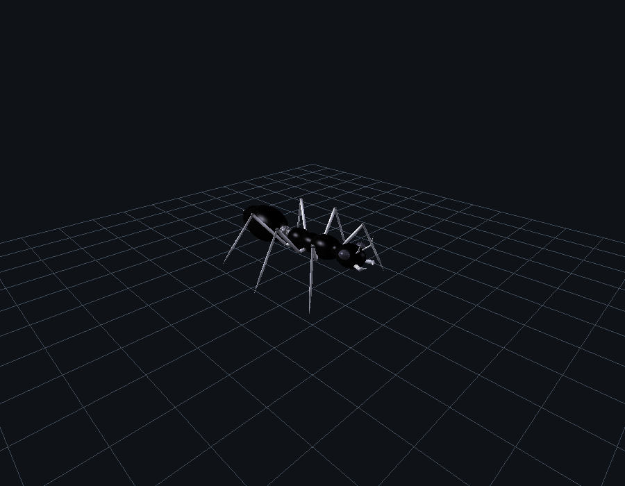

# Simulador 3D de Formiga Robô em OpenGL (Cyber Ant) 🐜🤖

Projeto Final da disciplina de **Computação Gráfica (IME 04-10842) -- 2026.1**  
**Instituto Militar de Engenharia (IME)**  
**Autor:** Mateus Henrique Freitas Maciel  
**Professor:** Paulo Cezar Pinto Carvalho  



---

## 📋 Sumário
- [Visão Geral](#-visão-geral)
- [Instruções de Compilação e Execução](#-instruções-de-compilação-e-execução)
- [Tabela Completa de Comandos](#-tabela-completa-de-comandos)
- [Anatomia e Modelagem Hierárquica](#-anatomia-e-modelagem-hierárquica)
- [Cinemática da Marcha (Tripod Gait)](#-cinemática-da-marcha-tripod-gait)
- [Mapeamento de Texturas BMP 24-bits](#-mapeamento-de-texturas-bmp-24-bits)
- [Sistema de Iluminação e Aspecto Metálico](#-sistema-de-iluminação-e-aspecto-metálico)
- [Checklist de Conformidade com o Edital](#-checklist-de-conformidade-com-o-edital)

---

## 🔍 Visão Geral

O projeto consiste em um simulador tridimensional interativo de uma **formiga robô bio-inspirada** desenvolvido em C++ utilizando estritamente **OpenGL clássico em pipeline fixo (`GL`, `GLU`, `GLUT` / `freeglut`)** e a biblioteca local `RgbImage` (Sam Buss), tomando como estrutura de partida o exemplo `garra.cpp`.

O software atende a 100% dos requisitos do edital:
1. **Modelagem Hierárquica:** Grafo de cena completo utilizando `glPushMatrix` e `glPopMatrix`.
2. **Câmera Orbital 3D:** Órbita esférica contínua de 360°, Pan no plano de visão e Zoom.
3. **Cadeia Cinemática das Pernas:** 6 pernas articuladas (3 pares: dianteiras, médias e traseiras) com 4 elos em série (Quadril $\to$ Coxa $\to$ Trocanter $\to$ Fêmur $\to$ Joelho $\to$ Tíbia $\to$ Garra).
4. **Locomoção Tripod Gait:** Marcha coordenada automática a 60 FPS com dois tripés estáticos alternados defasados em $180^\circ$.
5. **Multi-Texturização BMP:** 4 texturas independentes de 24-bits sem compressão aplicadas anatomicamente via `gluBuild2DMipmaps`.
6. **Iluminação Metálica:** Sistema de 2 fontes de luz com `GL_MODULATE`, separação especular (`GL_SEPARATE_SPECULAR_COLOR`), visualizador local e material de alto brilho reflexivo (`GL_SHININESS = 78.0f`).

---

## 🛠 Instruções de Compilação e Execução

### Ambiente Linux (Ubuntu, Debian, Fedora, Arch)
Certifique-se de possuir o compilador `g++` e a biblioteca `freeglut` instalados:
```bash
# Compilar e executar diretamente
make run

# Executar bateria de validação estrita (-Wall -Wextra -Werror)
make validate
```
*Comando de compilação manual:*
```bash
g++ -Wall -Wextra -Werror -O2 formiga.cpp RgbImage.cpp -lGL -lGLU -lglut -lm -o formiga
```

### Ambiente Windows (MinGW / GCC ou MSVC)
O código fonte possui compatibilidade nativa com Windows (diretiva `#define _CRT_SECURE_NO_WARNINGS` na linha 1 e inclusão de `<windows.h>`):
```bash
g++ -O2 formiga.cpp RgbImage.cpp -lfreeglut -lopengl32 -lglu32 -o formiga.exe
```
> **Nota:** Certifique-se de manter a biblioteca `freeglut.dll` e a pasta `_temp_textures/` no mesmo diretório do executável `formiga.exe`.

---

## 🎮 Tabela Completa de Comandos

A interação do usuário com o simulador ocorre de forma integrada via teclado e mouse:

| Entrada | Ação / Movimento | Descrição Funcional |
| :--- | :--- | :--- |
| **CÂMERA E VISUALIZAÇÃO** | | |
| `Mouse Esquerdo + Arraste` | Rotação Orbital 360° | Rotação esférica livre em torno do robô (azimute e elevação). |
| `Mouse Direito + Arraste` | Pan da Câmera | Translação do centro focal no plano da câmera. |
| `Scroll do Mouse` ou `+ / -` | Zoom In / Zoom Out | Aproxima e afasta a visão sem distorção projetiva. |
| `Setas do Teclado` | Órbita pelo Teclado | Rotação orbital nos eixos horizontal e vertical. |
| `W / S / A / D` | Navegação Clássica | Compatibilidade direta com o legado de `garra.cpp`. |
| `I / K` | Pan Vertical Teclado | Desloca verticalmente o alvo de observação. |
| `R / r` | Reset Geral | Restaura a câmera padrão, zera articulações e para a marcha. |
| **LOCOMOÇÃO AUTOMÁTICA** | | |
| **`Barra de Espaço`** | **Caminhada Tripod Gait** | **Ativa / Desativa a marcha coordenada de 6 patas a 60 FPS.** |
| **ARTICULAÇÃO MANUAL DAS 6 PATAS** | | |
| `1 / 2` | Articulação da Coxa (Yaw) | Avança (+Yaw) ou recua (-Yaw) as coxas no plano horizontal. |
| `3 / 4` | Articulação do Fêmur (Pitch) | Eleva (+Pitch) ou abaixa (-Pitch) os joelhos das 6 patas. |
| `5 / 6` | Articulação da Tíbia (Pitch) | Flexiona (+Pitch) ou estende (-Pitch) as tíbias em direção ao piso. |
| **CABEÇA E APÊNDICES FRONTAIS** | | |
| `H / h` | Pitch da Cabeça | Inclina a cabeça para cima (`h`) ou para baixo (`H`). |
| `Y / y` | Yaw da Cabeça | Gira o pescoço para a esquerda (`y`) ou para a direita (`Y`). |
| `J / j` | Mandíbulas em Pinça | Abre (`j`) ou fecha (`J`) as mandíbulas (com trava física). |
| `U / u` | Antenas Articuladas | Eleva (`u`) ou abaixa (`U`) as antenas no cotovelo esférico. |
| **ABDÔMEN, FERRÃO E RENDERIZAÇÃO** | | |
| `B / b` | Pitch do Abdômen/Gáster | Eleva (`b`) ou curva para baixo (`B`) o gáster em pose de ataque. |
| `N / n` | Yaw do Abdômen | Move o abdômen lateralmente para esquerda (`n`) ou direita (`N`). |
| `T / t` | Alternância de Textura | Liga / Desliga o mapeamento de texturas BMP em tempo real. |
| `P / p` | Captura de Tela | Salva captura BMP 24-bits em `docs/screenshot_formiga.bmp`. |
| `ESC` | Encerrar | Fecha a aplicação e libera os recursos gráficos. |

---

## 🏛 Anatomia e Modelagem Hierárquica

O modelo tridimensional é organizado como uma árvore hierárquica de transformações afins:

```text
Tórax (Raiz - Protórax, Mesotórax, Metatórax)
 ├── Cabeça (Filha anterior do Protórax)
 │    ├── Pescoço e Crânio principal
 │    ├── Olhos Compostos (Esquerdo e Direito)
 │    ├── Mandíbulas em Pinça (Esquerda e Direita)
 │    └── Antenas Bi-articuladas (Escapo + Cotovelo + Flagelo)
 ├── Abdômen (Filho posterior do Metatórax)
 │    ├── Cintura Dupla Articulada (Pecíolo e Pós-Pecíolo)
 │    ├── Gáster Volumoso (Bulbo principal + Anel posterior)
 │    └── Ferrão Mecânico Cônico
 └── Seis Pernas Articuladas (3 de cada lado)
      ├── Par Dianteiro (L1 / R1) no Protórax (+38° base)
      ├── Par Médio (L2 / R2) no Mesotórax (-10° base)
      └── Par Traseiro (L3 / R3) no Metatórax (-55° base, mais longo)
           └── Por Perna: Quadril -> Coxa -> Trocanter -> Fêmur -> Joelho -> Tíbia -> Garra
```

Todas as 6 garras repousam analiticamente no plano do piso em $Z = -1.65$.

---

## 🏃 Cinemática da Marcha (Tripod Gait)

A marcha em tripé alternado divide as 6 patas em dois grupos complementares em oposição de fase ($\Delta \phi = \pi$):
* **Tripé A ($\phi_A = t$):** Dianteira Esquerda ($L_1$), Média Direita ($R_2$) e Traseira Esquerda ($L_3$).
* **Tripé B ($\phi_B = t + \pi$):** Dianteira Direita ($R_1$), Média Esquerda ($L_2$) e Traseira Direita ($R_3$).

Durante a **Fase de Balanço** ($\sin \phi > 0$), a pata se eleva do solo e avança no ar ($\theta_{\text{coxa}} \to +A$, $\theta_{\text{fêmur}} > 0$).  
Durante a **Fase de Apoio** ($\sin \phi \le 0$), a pata permanece cravada no plano $Z = -1.65$ e empurra o solo para trás ($\theta_{\text{coxa}} \to -A$, $\theta_{\text{fêmur}} = 0$).

---

## 🎨 Mapeamento de Texturas BMP 24-bits

O projeto utiliza **4 texturas especializadas** em formato BMP de 24-bits sem compressão RLE, localizadas na pasta `_temp_textures/`:

| Arquivo BMP | Localização | Cor Base (`glColor3f`) | Partes Anatômicas Mapeadas |
| :--- | :--- | :--- | :--- |
| `carbon_fiber1.bmp` | `_temp_textures/` | `(0.20, 0.20, 0.22)` (Escuro) | **Carapaça Principal:** Crânio, tórax (3 segmentos) e gáster. |
| `corrugated_iron.bmp` | `_temp_textures/` | `(0.80, 0.80, 0.85)` (Prata) | **Cintura e Juntas:** Pecíolo/pós-pecíolo e juntas de quadril, trocanter e joelho. |
| `gray_metal.bmp` | `_temp_textures/` | `(0.90, 0.90, 0.95)` (Cromo) | **Membros e Apêndices:** Cilindros das pernas, garras, antenas, mandíbulas e ferrão. |
| `perforated_metal.bmp` | `_temp_textures/` | `(0.25, 0.25, 0.30)` (Metálico) | **Olhos:** Hemisférios oculares com textura perfurada industrial. |

*Fallback:* Caso a pasta `_temp_textures/` não esteja presente, o simulador carrega automaticamente a textura padrão `metalTexture1.bmp` da raiz.

---

## 💡 Sistema de Iluminação e Aspecto Metálico

- **Fontes de Luz Ativas:**
  - `GL_LIGHT0` (Luz Chave Frontal): Posição $(10.0, -8.0, 14.0)$, Difusa `(0.80, 0.80, 0.85)`, Especular `(0.75, 0.75, 0.80)`.
  - `GL_LIGHT1` (Luz de Preenchimento Traseira): Posição $(-10.0, 8.0, 4.0)$, Difusa `(0.30, 0.30, 0.35)`, Especular `(0.30, 0.30, 0.35)`.
- **Modo `GL_MODULATE`:** Combina a cor e iluminação aos texels das imagens BMP.
- **Separação Especular (`GL_SEPARATE_SPECULAR_COLOR`):** Permite que o reflexo especular branco seja somado sobre a textura após a modulação, preservando o brilho vívido sobre a fibra de carbono escura.
- **Visualizador Local (`GL_LIGHT_MODEL_LOCAL_VIEWER`):** Ativado para calcular o vetor de reflexão exato de cada vértice em relação à câmera orbital em tempo real.
- **Propriedades do Material:** `GL_SPECULAR = { 0.70, 0.70, 0.75, 1.0 }` com expoente `GL_SHININESS = 78.0f` (dentro da faixa exigida de 70 a 90).

---

## ✅ Checklist de Conformidade com o Edital

| Item | Requisito do Edital (CG 2026.1) | Status no Projeto |
| :---: | :--- | :---: |
| **1** | Simulador de formiga robô em OpenGL baseado em `garra.cpp` | **CONCLUÍDO (100%)** |
| **2** | Anatomia obrigatória: cabeça, olhos, antenas, tórax, abdômen e 6 pernas | **CONCLUÍDO (100%)** |
| **3** | Movimentação independente de cabeça, antenas e pernas (individual/grupo) | **CONCLUÍDO (100%)** |
| **4** | Simulação de caminhada coordenada (Tripod Gait) | **CONCLUÍDO (100%)** |
| **5** | Interação do usuário via teclado e mouse | **CONCLUÍDO (100%)** |
| **6** | Movimentos de câmera (Zoom, Pan e Rotação Orbital 360°) | **CONCLUÍDO (100%)** |
| **7** | Texturização dos materiais com imagens BMP via `RgbImage` | **CONCLUÍDO (4 Texturas)** |
| **8** | Viewport com transformação projetiva (`gluPerspective`) e iluminação metálica | **CONCLUÍDO (100%)** |
| **Extra** | Manual de Instruções oficial no formato PDF | **`Manual_Instrucoes.pdf` (5 págs)** |

---

*Desenvolvido para a disciplina de Computação Gráfica (IME 04-10842) - Trabalho Final 2026.1.*
