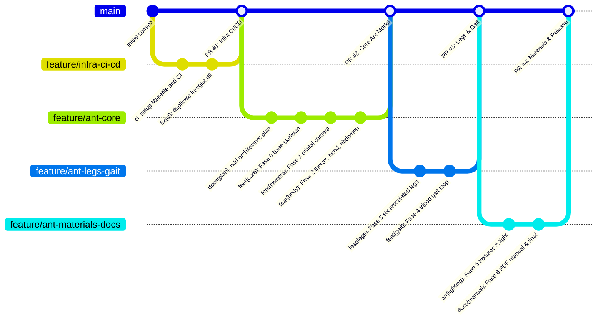

# Fluxo de Desenvolvimento, Git e Roteiro de Fases: Cyber Ant 3D

> **Disciplina:** Computação Gráfica (IME 04-10842) - Trabalho Final 2026.1  
> **Projeto:** Simulador de Formiga Robô 3D em OpenGL  
> **Repositório:** `openGL-cyber-ant`  

---

## 1. Visão Geral da Estratégia Git

Para evitar commits gigantes ("monolíticos") ao final do projeto e garantir rastreabilidade, qualidade contínua e conformidade estrita com o edital do professor, o desenvolvimento é organizado em **branches temáticas** com **commits atômicos e granulares** orientados ao padrão [*Conventional Commits*](https://www.conventionalcommits.org/).

### Estrutura de Branches:



---

## 2. Divisão em Fases e Roteiro de Implementação

| Fase | Título / Objetivo | Branch Responsável | Commits Planejados | Critério de Aceite / Teste |
| :---: | :--- | :--- | :--- | :--- |
| **0** | **Esqueleto Base & Pipeline Local** | `feature/ant-core` | `docs(plan): ...`<br>`feat(core): ...` | `make validate` passa 100% limpo com `-Wall -Werror`; janela abre com esfera e chão referencial. |
| **1** | **Câmera 3D Completa** (Órbita, Zoom e Pan) | `feature/ant-core` | `feat(camera): implement 360 orbital camera, zoom and pan` | Rotação orbital no mouse e setas; Zoom no scroll e `+`/`-`; Pan no botão direito e setas; reset em `r`. |
| **2** | **Corpo Principal Hierárquico** (Tórax, Cabeça e Abdômen) | `feature/ant-core` | `feat(body): model hierarchical thorax, abdomen with stinger and articulated head` | Cabeça articula com pitch e yaw (`h/H`, `y/Y`); mandíbulas abrem/fecham (`j/J`); antenas dobram (`u/U`); gáster e ferrão alinhados. |
| **3** | **6 Patas Articuladas Modulares** | `feature/ant-legs-gait` | `feat(legs): implement modular 3-segment articulated hexapod legs` | 6 patas com Coxa $\rightarrow$ Fêmur $\rightarrow$ Tíbia; tocam o solo simetricamente; articulação manual individual sem quebrar a raiz. |
| **4** | **Marcha Automática Tripod Gait** | `feature/ant-legs-gait` | `feat(gait): add coordinated tripod gait animation loop at 60 FPS` | Tecla `Espaço` alterna caminhada contínua; alternância sincronizada entre Tripé A e Tripé B a 60 FPS estáveis. |
| **5** | **Iluminação Phong e Texturas Metálicas** | `feature/ant-materials-docs` | `art(lighting): configure metallic Phong materials and BMP texture mapping` | Superfícies com `gluQuadricTexture` e `metalTexture1.bmp`; luz especular reativa em tempo real; toggles `l/L` e `t/T`. |
| **6** | **Manual PDF, Documentação e Pacote Final** | `feature/ant-materials-docs` | `docs(manual): generate Manual_Instrucoes.pdf and update README controls` | `Manual_Instrucoes.pdf` gerado para o professor; `README.md` atualizado; pacote `entrega_final/` montado sem arquivos proibidos. |

---

## 3. Padrão de Mensagens de Commit

Utilizar exclusivamente mensagens no padrão *Conventional Commits*:

- `feat(...)`: Novas funcionalidades de código 3D (câmera, partes anatômicas, animação).
- `fix(...)`: Correção de bugs visuais, falhas de matriz ou cálculo de ângulos.
- `art(...)`: Ajustes de textura, materiais metálicos, luzes ou estética gráfica.
- `docs(...)`: Criação ou atualização de documentação técnica, manuais em PDF ou planejamento.
- `build(...)`: Alterações no `Makefile`, scripts de compilação ou flags do compilador.
- `ci(...)`: Ajustes no fluxo de trabalho do GitHub Actions (`.github/workflows/ci.yml`).

### Exemplos Válidos:
```text
feat(camera): implement 360 orbital camera, zoom and pan via mouse and keyboard
feat(body): model hierarchical thorax, abdomen with stinger and articulated head
feat(legs): implement modular 3-segment articulated hexapod legs
feat(gait): add coordinated tripod gait animation loop at 60 FPS
art(lighting): configure metallic Phong materials and BMP texture mapping
docs(manual): generate Manual_Instrucoes.pdf and update README controls
```

---

## 4. Protocolo Obrigatório Pré-Commit e Pré-Push

Antes de executar qualquer commit ou push, o desenvolvedor (ou agente) **DEVE** seguir este checklist:

### Passo 1: Validação Automatizada Local
```bash
make validate
```
- [x] O comando deve exibir `==> VALIDACAO CONCLUIDA COM SUCESSO!`.
- [x] Nenhuma flag de warning deve ser tolerada (`-Wall -Wextra -Werror`).
- [x] A linha 1 de `formiga.cpp` deve ser `#define _CRT_SECURE_NO_WARNINGS`.
- [x] `#ifdef _WIN32` deve proteger os cabeçalhos de sistema operacional.
- [x] As imagens `.bmp` devem ser validadas como 24-bits e dimensões potência de 2.

### Passo 2: Teste Visual
```bash
make run
```
- [x] Validar os controles correspondentes à fase em desenvolvimento.
- [x] Garantir que não há vazamento na pilha de matrizes do OpenGL (`glPushMatrix`/`glPopMatrix` desbalanceados).

### Passo 3: Verificação de Arquivos Proibidos no Git
```bash
git status
```
- [x] **NUNCA adicionar ao Git:**
  - `AGENTS.md` ou pasta `.agents/`
  - `CG20261_Trabalho_Final.pdf`
  - Binários ELF de Linux (`formiga`, `garra`, `test_bmp_loader`)
  - Objetos temporários (`*.o`, `*.out`)
  - Pasta temporária `entrega_final/`

### Passo 4: Commit e Push
```bash
git add <arquivos-especificos>
git commit -m "tipo(escopo): mensagem descritiva"
git push origin <nome-da-branch>
```

---

## 5. Ciclo de Pull Requests e Integração Contínua (CI)

Ao concluir todas as fases de uma branch temática:

1. **Abrir Pull Request no GitHub:** Apontando da branch `feature/*` para a `main`.
2. **Aguardar Validação do CI:**
   - **`build-linux`**: Compila no Ubuntu e roda teste gráfico headless via `xvfb-run timeout 2s ./formiga` para garantir ausência de *Segmentation Faults*.
   - **`build-windows`**: Compila via MinGW64 no Windows nativo e gera o artefato zipado (`formiga.exe` + `freeglut.dll` + `.bmp`).
3. **Merge com a `main`:** Manter a branch `main` sempre estável, funcional e pronta para entrega.
4. **Criar a próxima branch temática:** A partir da `main` atualizada.
