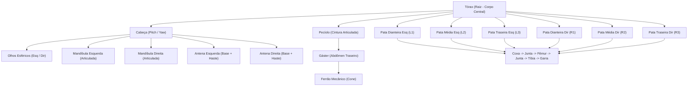
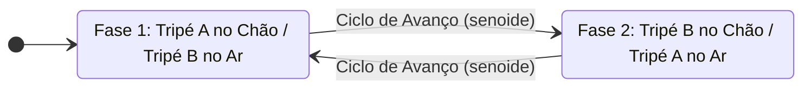

# Planejamento de Arquitetura e Modelagem: Formiga Robô 3D em OpenGL

> **Disciplina:** Computação Gráfica (IME 04-10842) - Trabalho Final 2026.1  
> **Arquivo de Referência:** `CG20261_Trabalho_Final.pdf`  
> **Ponto de Partida:** `garra.cpp`  
> **Branch de Trabalho:** `feature/ant-core`  

---

## 1. Visão Geral e Requisitos do Edital

O objetivo deste projeto é implementar uma simulação interativa de uma **Formiga Robô 3D** utilizando estritamente **OpenGL clássico** (pipeline fixo), `GLU`, `GLUT` e a biblioteca local `RgbImage`.

### Checklist de Requisitos Obrigatórios:
- [x] **Anatomia Completa:** Cabeça articulada (olhos, mandíbulas, 2 antenas articuladas), Tórax (corpo central/raiz), Pecíolo/Abdômen (gáster com ferrão) e 6 Patas articuladas (coxa, fêmur, tíbia).
- [x] **Movimentação Independente:** Teclas para articular cabeça, mandíbulas, antenas e patas individualmente.
- [x] **Simulação de Caminhada:** Modo automático de marcha *Tripod Gait* (alternância coordenada dos dois tripés de patas).
- [x] **Câmera Interativa:** Controle de Zoom e Pan via teclado e mouse, com rotação orbital em 360°.
- [x] **Projeção:** Viewport configurada com projeção perspectiva (`gluPerspective`).
- [x] **Aspecto Artístico:** Iluminação Phong metálica de alto contraste (`glLightfv`, `glMaterialfv`) e mapeamento de texturas BMP de 24-bits via `RgbImage` e `gluQuadricTexture`.

---

## 2. Diagrama da Árvore Hierárquica de Transformações (Cena 3D)

A modelagem matemática do robô baseia-se em uma árvore de transformações geométricas encadeadas com a pilha de matrizes do OpenGL (`glPushMatrix` e `glPopMatrix`). O **Tórax** é a raiz global do robô:

---

## 3. Cinemática da Marcha: Tripod Gait (Caminhada em Tripé)

Na locomoção de insetos e robôs hexápodes, 3 patas tocam o solo formando um tripé de suporte estático enquanto as outras 3 se levantam e avançam para a frente.

* **Tripé A:** Dianteira Esquerda ($L_1$), Traseira Esquerda ($L_3$) e Média Direita ($R_2$).
* **Tripé B:** Dianteira Direita ($R_1$), Traseira Direita ($R_3$) e Média Esquerda ($L_2$).
* **Fórmula Angular de Animação:**
  $$\theta_{\text{pata}}(t) = A \cdot \sin(\omega t + \phi)$$
  Onde $\phi = 0$ para o Tripé A e $\phi = \pi$ para o Tripé B, gerando o movimento oposto sincronizado.

---

## 4. Arquitetura Modular do Código (`formiga.cpp`)

O programa será estruturado nos seguintes blocos lógicos:

1. **Definições e Includes:**
   - Linha 1: `#define _CRT_SECURE_NO_WARNINGS`
   - Proteção de SO: `#ifdef _WIN32 #include <windows.h> #endif`
   - Includes: `<GL/glut.h>`, `<math.h>`, `"RgbImage.h"`
2. **Gerenciamento de Recursos e Texturas:**
   - Inicialização de quádricas (`gluNewQuadric`, `gluQuadricNormals`, `gluQuadricTexture`).
   - Carga da textura `metalTexture1.bmp` com validação de dimensões em potência de 2.
3. **Câmera Orbital e Viewport Projetiva:**
   - `gluPerspective(60.0, aspect, 0.5, 100.0)`.
   - Câmera esférica com coordenadas $(r, \theta, \phi)$ e foco no alvo $(targetX, targetY, targetZ)$ para suporte a **Pan**.
4. **Funções de Desenho Hierárquico:**
   - `drawThorax()`: Tórax metálico segmentado.
   - `drawHead()`: Cabeça articulada, mandíbulas em pinça e antenas bi-segmentadas.
   - `drawAbdomen()`: Pecíolo elíptico, gáster volumoso e ferrão terminal.
   - `drawLeg(side, index, angles)`: Modelagem genérica e reutilizável de pata (Coxa $\rightarrow$ Fêmur $\rightarrow$ Tíbia).
5. **Iluminação e Materiais:**
   - Luz ambiente, difusa e especular (`GL_LIGHT0`).
   - Material metálico polido de alto contraste (Cyber Ant).
6. **Controles e Callbacks GLUT:**
   - `handleKeypress`, `handleSpecialKeypress`: Mapeamento de teclas de articulação, caminhada e câmera.
   - `handleMouseMotion`, `handleMouseWheel`: Rotação orbital, Pan e Zoom via mouse.
   - `updateAnimation`: Loop contínuo com `glutTimerFunc`.

---

## 5. Tabela de Controles Interativos

| Grupo | Tecla / Ação | Função |
| :--- | :--- | :--- |
| **Câmera (Órbita)** | Botão Esquerdo do Mouse + Arrastar (ou `w`, `s`, `a`, `d`) | Rotaciona o ponto de vista ao redor do robô |
| **Câmera (Zoom)** | Scroll do Mouse (ou `+` / `-`) | Aproxima ou afasta a câmera |
| **Câmera (Pan)** | Botão Direito do Mouse + Arrastar (ou `Setas`) | Move o centro de foco da visão horizontal e verticalmente |
| **Caminhada Automática** | `Espaço` | Liga/Desliga o modo contínuo de caminhada (*Tripod Gait*) |
| **Cabeça** | `h` / `H` e `y` / `Y` | Inclina para cima/baixo e gira para os lados |
| **Mandíbulas** | `j` / `J` | Abre e fecha as pinças da mandíbula |
| **Antenas** | `u` / `U` | Articula as duas antenas |
| **Patas (Manual)** | `1` / `2` e `3` / `4` | Articula grupos de patas manualmente |
| **Iluminação** | `l` / `L` | Liga / desliga a iluminação OpenGL |
| **Textura** | `t` / `T` | Liga / desliga a textura metálica |
| **Reset / Sair** | `r` (Reset Câmera) / `Esc` (Sair) | Restaura os ângulos padrão ou fecha o programa |
